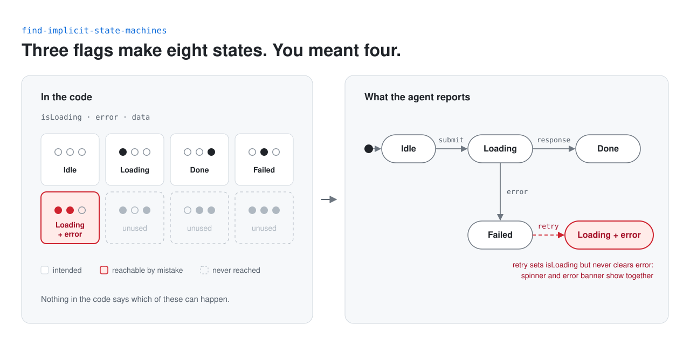
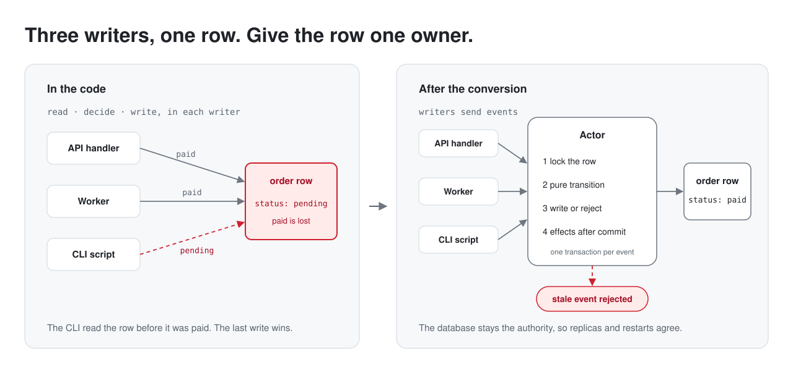
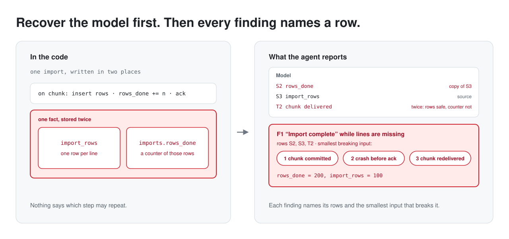

# skills

[](https://skills.sh/kr4chinin/skills)

Agent skills for Claude Code, Codex, Cursor and other agents supported by the
[`skills`](https://github.com/vercel-labs/skills) CLI.

```sh
npx skills add kr4chinin/skills --skill <name>
```

## find-implicit-state-machines

Finds the implicit state machines in a codebase: states and transitions spread
across flags, status fields, timers and callbacks instead of being declared in
one place. It reports the ones that can get stuck, reach impossible states or
race, each with a state diagram and a fix.

<picture>
  <source media="(prefers-color-scheme: dark)" srcset="assets/find-implicit-state-machines/diagram-dark.svg">
  
</picture>

```sh
npx skills add kr4chinin/skills --skill find-implicit-state-machines
```

> Find all of the implicit state machines in my app.

The audit is read-only. Each finding is labelled Confirmed, Likely or Smell,
depending on how far it was traced through the code.

Inspired by [this post](https://x.com/steveruizok/status/2116552016218710389)
by Steve Ruiz.

## convert-state-machines-to-actors

Fixes an implicit state machine whose state lives in a database by turning it
into an actor: one owner that every writer goes through, a pure transition
function, and one guarded atomic write per event. The database stays the
authority, so it works across replicas and restarts.

<picture>
  <source media="(prefers-color-scheme: dark)" srcset="assets/convert-state-machines-to-actors/diagram-dark.svg">
  
</picture>

```sh
npx skills add kr4chinin/skills --skill convert-state-machines-to-actors
```

> Convert the implicit state machines you found in the database to actors.

It is the follow-up to
[find-implicit-state-machines](#find-implicit-state-machines): that skill finds
the machines, this one converts them when a single conditional write is not
enough. It starts from a test that reproduces the race in two database
sessions on the production engine, lists every code path that writes the
state, including workers, CLI tools and seed scripts, names writers in other
services it cannot move, and moves the writers in this repository to the
actor, except listed bypasses that keep the same guard. The actor works on
any store that can guard a write: row locks, compare-and-set or conditional
writes. The race counts as fixed only when the database itself decides the
losing session. For several machines it writes a plan and converts one actor
per change.

## recover-semantic-model

Recovers a program's minimal semantic model before judging the code: the
state that changes what the user sees, which transitions commute, repeat
safely or depend on order, and what must be true before each effect fires.
It then looks for nondeterminism in awaits, retries and event order,
invariants nobody enforces, one fact stored in two places, and work that
never reaches the screen.

<picture>
  <source media="(prefers-color-scheme: dark)" srcset="assets/recover-semantic-model/diagram-dark.svg">
  
</picture>

```sh
npx skills add kr4chinin/skills --skill recover-semantic-model
```

> Recover my program's minimal semantic model.

The audit is read-only. The model comes first, as three tables, and every
finding names the rows it violates and the smallest input that breaks it: a
numbered event sequence that becomes the regression test almost unchanged.
Each fix says whether it is a bug fix, a behaviour change for the owner to
decide or a contract needed from another system. Asked about refactors, it
splits a diff into provably equivalent and "trust me" changes, each "trust
me" with its smallest breaking input.

It works on its own and names
[find-implicit-state-machines](#find-implicit-state-machines) and
[convert-state-machines-to-actors](#convert-state-machines-to-actors) where
they go deeper; when one is not installed, it reports what was left out.

Inspired by [this post](https://x.com/infinterenders/status/2119676620680339490)
by render ([@infinterenders](https://x.com/infinterenders)).

## License

MIT
