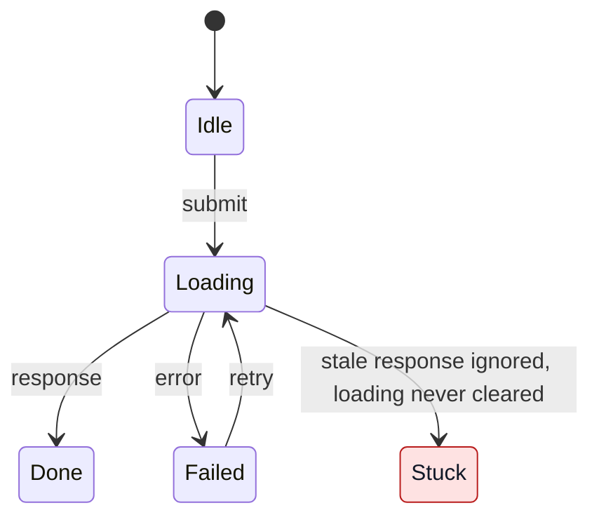

# Find implicit state machines

An implicit state machine has states and transitions that are not declared in
one place but spread across variables, handlers, callbacks and timers. Find
and reconstruct them to audit for defects or build an explicitly requested
inventory. Finding a machine does not mean finding a bug.

Stay read-only: don't edit code or create tickets unless asked.

## 1. Scope

Use the scope the user gave. If the repository holds several apps and there is
no hint, ask which one. Report what you included and skipped.

Default to a defect audit: report the broken or fragile machines. When the user
explicitly requests an inventory (for example, "all machines"), include a compact
catalog of identified machines with their locations and review outcomes,
including "no defect found" for fully traced machines without a finding. Retain
these in the catalog even when dropped from defect findings. Continue
investigating suspected defects and use the evidence labels below for findings.

In either mode, distinguish discovery scope (where you searched), fully traced
paths, and unreviewed candidates. State coverage gaps; search hits and file
counts do not establish exhaustive coverage.

## 2. Find candidates

Search for units (module, component, class, service) where two or more of these
meet:

- several booleans describing one process;
- a status, phase or step field assigned from many places, with no transition
  table;
- mutable references or instance fields used as state;
- flags that are set once and never reset;
- hand-written polling, retry, debounce or autosave loops;
- cancel, reset or close that clears some fields but not all;
- async results applied without checking they are still current;
- state reset by comparing against a stored previous value;
- mutually exclusive UI elements, each with its own flag;
- the same flow copied into several places.

A single loading flag, or framework-managed state with nothing layered on top,
is not a finding.

On a large codebase, split it into parts of similar file count and run
read-only subagents in parallel if available. Give each one the list above and
ask for `path:line`, the suspected event sequence, and whether it read the
whole path or guessed. Treat their results as leads, not findings.

## 3. Reconstruct and verify

For each candidate, read the whole code path and write down the state
variables, the intended states, the reachable combinations, the events (user
actions, responses, errors, timers, teardown) and the transitions. Check for:

- an impossible combination that is reachable;
- a state with no way out;
- an incomplete reset;
- a race: a stale result overwrites newer state, or one action runs twice;
- work lost on teardown, or timers left running;
- a loop with no terminal or error state;
- copies that have drifted apart.

Before confirming, look for what makes the sequence impossible: a remount
(component keys, route changes), disabled or hidden UI, guards in callers, and
framework guarantees.

Label each finding by the code trace; state any doubt about user impact in the
text:

- **Confirmed**: you traced every step of the failing sequence in the code.
- **Likely**: one step depends on runtime behaviour you could not confirm. Name
  that step.
- **Smell**: works today, but only by convention, ordering or a guarantee
  elsewhere. Name it.

Drop candidates that turn out to be fine, and report how many you dropped. Don't claim anything was run or
reproduced unless you did it.

## 4. Report

Write in the user's language. Order findings Confirmed, then Likely, then
Smell; within each group, user-facing flows first.

1. A one-sentence summary and a table: number, `path:line`, machine, problem,
   label.
2. For each Confirmed or Likely finding:
   - the state variables;
   - a Mermaid `stateDiagram-v2` of the actual behaviour with the bad state
     marked by a `classDef`; for a timing race, a `sequenceDiagram` instead;
   - the failing event sequence, with `path:line` for each step;
   - what the user sees;
   - the smallest fix, and a regression test that replays the sequence.
3. Patterns seen in three or more places, with their locations.
4. Smells, one line each.
5. What was not covered.

Keep diagrams under about 12 states and use the same state names as the text.
For example, a request whose stale response is ignored without clearing the
loading state:

### Diagram readability and publishing

Check rendered diagrams in both light and dark themes, especially highlighted
states, notes and sequence regions. Pair every custom node fill with an explicit
contrasting text colour, as in the example above. Use translucent sequence
highlights so the theme's text stays readable on its background.

Include diagrams as native Mermaid blocks in the report. Publish to a tracker
or document only when the user explicitly requests it. When publishing, verify
that the diagrams render there with readable labels and contrast in both themes
before reporting publication complete; saved source alone does not prove the
diagram is visible.

## Fixes

Recommend the lightest change that removes the defect:

- one tagged union or enum instead of parallel flags;
- one transition function when transitions are scattered;
- a statechart library only for hierarchy, parallel regions or timers;
- a request id, generation counter or cancellation for races;
- one owner per loop, with an attempt limit and a terminal error state,
  stopped on teardown;
- re-creating the unit instead of resetting its fields when its identity
  changes;
- one shared module for copied flows.
