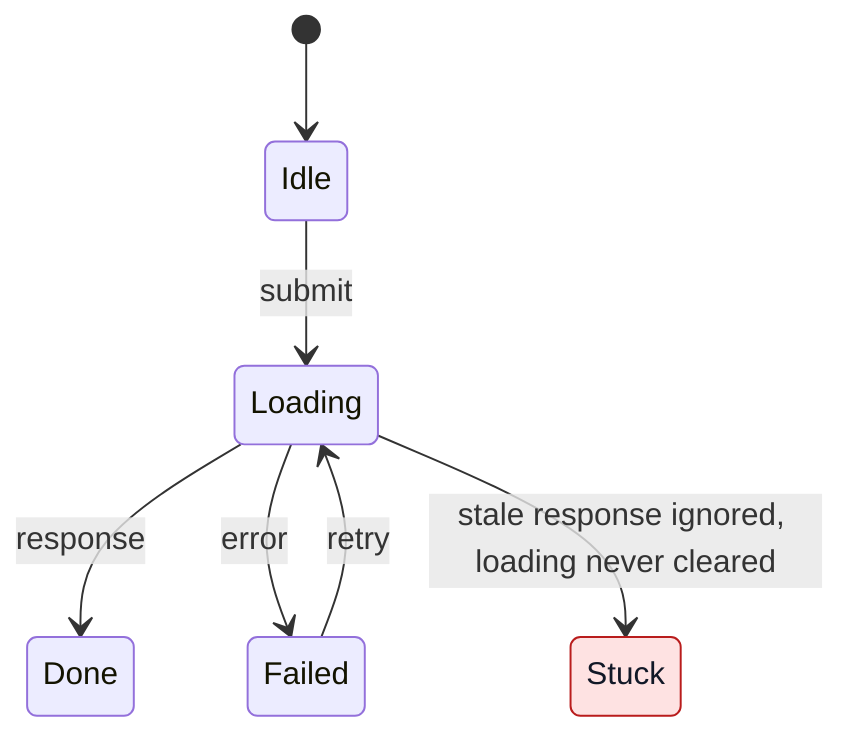

# Find implicit state machines

An implicit state machine has states and transitions that are not declared in
one place but spread across variables, handlers, callbacks and timers.
Finding a machine does not mean finding a bug.

Stay read-only: don't edit code or create tickets unless asked.

## 1. Scope

Use the scope the user gave. If the repository holds several apps and there is
no hint, ask which one.

Default to a defect audit: report the broken or fragile machines, also when
asked to find all of them. Only an explicit request for an inventory (for
example, "catalog all machines, including ones with no defect") adds a compact
catalog with locations and review outcomes, including "no defect found" for
fully traced machines without a finding. Suspected defects are still
investigated and labelled as below.

In either mode, report what you included and skipped: distinguish discovery
scope (where you searched), fully traced paths, and unreviewed candidates.
State coverage gaps; search hits and file counts do not establish exhaustive
coverage.

## 2. Find candidates

Prioritize units (module, component, class, service) where two or more of these
signals meet; a concrete reachable failure can warrant tracing a candidate with
only one signal:

- several booleans describing one process;
- a status, phase or step field assigned from many places, with no transition
  table;
- mutable references or instance fields used as state;
- flags that are set once and never reset;
- queues, workers, leases or persisted workflows; for these backend candidates,
  read [distributed lifecycle checks](references/distributed-lifecycles.md) to
  trace ownership, persistence and recovery across process boundaries;
- hand-written polling, retry, debounce or autosave loops;
- cancel, reset or close that clears some fields but not all;
- async results applied without checking they are still current;
- state reset by comparing against a stored previous value;
- mutually exclusive UI elements, each with its own flag;
- the same flow copied into several places.

An existing enum, reducer or statechart does not rule out implicit
coordination across components. A lone loading flag or ordinary
framework-managed state without evidence of a failure or fragile coordination
is still insufficient.

The search is done when every in-scope unit where two or more signals meet is
either traced in step 3 or listed as an unreviewed candidate.

On a large codebase, delegate read-only searches only when authorized,
compatible with the user's constraints, and supported by available tools;
otherwise do the audit yourself. Split bounded, disjoint scopes by domain or
lifecycle. Assign shared code to one subagent and identify cross-scope
handoffs so complete paths can be traced. Give each subagent its scope, relevant
candidate heuristics and verification requirements, including applicable
references; no recursive delegation unless the user explicitly requests it.

For suspected defects, each subagent returns compact leads: the intended
invariant, state variables, complete event sequence with `path:line` for each
step, protections checked, any unknown step, smallest fix, and scope limits.
Ruled-out candidates come back separately with the protections that resolved
them, without an invented failure or fix. Validate and deduplicate leads before
selecting final findings; generate diagrams only after that selection.

## 3. Reconstruct and verify

For each candidate, state the intended invariant and trace a concrete, reachable
event sequence that would violate it. Read the whole code path and write down
the state variables, intended states, reachable combinations, events (user
actions, responses, errors, timers, teardown) and transitions. Check for:

- an impossible combination that is reachable;
- a state with no way out;
- an incomplete reset;
- a race: a stale result overwrites newer state, or one action runs twice;
- work lost on teardown, or timers left running;
- a loop with no terminal or error state;
- copies that have drifted apart.

Actively try to disprove the sequence: check callers and their guards, remounts
(component keys, route changes), disabled or hidden UI, worker/consumer
registration, locks, transactions and concurrency tokens. Trace recovery paths
and check whether degradation or manual recovery is intentionally accepted
before treating it as a defect. Verify framework assumptions against installed
versions and relevant source or official documentation, following the
repository's documentation policy.

If uncertainty remains, choose the smallest meaningful execution within the
audit's authorized scope, preferring local isolated checks. This skill grants
no access to production or other shared systems.

Label each finding by the code trace; state any doubt about user impact in the
text:

- **Confirmed**: you traced every step of the failing sequence in the code.
  A complete static trace is sufficient: the label neither requires nor
  implies runtime reproduction.
- **Likely**: one step depends on runtime behaviour you could not confirm, or
  on a check that was unavailable or unauthorized. Name that step.
- **Smell**: works today, but only by convention, ordering or a guarantee
  elsewhere. Name it.

Report the evidence method separately from the label: `static trace`,
`isolated execution`, `integration execution` or `production evidence` (list
all used). Say which tests you read and which you ran, and what each executed
check exercises: a source-method call, an extracted method or a fake is no
proof of broker, database, SDK, transport or deployment behaviour. Include
runtime/version, command and artifact details only for checks actually run.

Report impact/severity separately from both: what the user or caller observes
(a stuck control, wrong data, a repeated side effect, lost work) and whether
normal use reaches it. Use a severity scale only if the project has one.

In a defect audit, drop candidates that turn out to be fine and report how
many you dropped. In an inventory, keep them in the catalog as "no defect
found", with the protection that cleared them.

## 4. Report

Publish only when explicitly requested, into tasks or documents the user
authorized creating or updating. Carry each finding's label, evidence method,
impact/severity and caveats with its native Mermaid and source links pinned to
the audited revision. Keep the Mermaid editable; substitute a PNG only on
request. Publication is complete when the destination renders the diagrams
with readable labels and contrast in both themes; saved source alone does not
prove visibility. If a rendering check is unavailable, state which check
remains unverified.

Write in the user's language. Order findings Confirmed, then Likely, then
Smell; within each group, user-facing flows first.

1. A one-sentence summary and a table: number, `path:line`, machine, problem,
   label, evidence method, impact/severity.
2. For each Confirmed or Likely finding:
   - a plain-language title stating what happens, then the triggering
     condition, consequence (including what the user sees) and expected
     behaviour; avoid jargon-only titles;
   - compact source evidence: the state variables and failing event sequence,
     with `path:line` for each step and any unconfirmed runtime step named;
   - a Mermaid `stateDiagram-v2` of the actual behaviour with the bad state
     marked by a `classDef`; for a timing race, a `sequenceDiagram` instead;
   - the smallest fix; describe the regression test that replays the sequence.
3. Group findings that share a cause and fix, regardless of copy count. Explain
   one representative in full and list every affected location with any
   meaningful differences; do not hide distinct failure sequences in a group.
4. Smells, briefly naming the contract they rely on. Expand them or create
   follow-up tasks only when requested.
5. In an inventory, the catalog: `path:line`, machine and review outcome.
6. What was not covered, and how many candidates you dropped.

### Diagram readability

Use native Mermaid blocks, keep diagrams under about 12 states, and match the
state names in the text. For example, a stale response that leaves loading set:

Check final rendered diagrams in light and dark themes, especially highlighted
states, notes and sequence regions. Pair every custom fill with an explicit
contrasting text colour. Use translucent sequence highlights so the theme's text
stays readable on its background.

## Fixes

Recommend the lightest change that removes the defect:

- one tagged union or enum instead of parallel flags;
- one transition function when transitions are scattered;
- a statechart library only for hierarchy, parallel regions or timers;
- a request id, generation counter or cancellation for an in-process race;
- one owner per loop, with an attempt limit and a terminal error state,
  stopped on teardown;
- re-creating the unit instead of resetting its fields when its identity
  changes;
- one shared module for copied flows.

For a queue, worker, lease or persisted workflow, the fix closes the failed
item of the [distributed lifecycle checks](references/distributed-lifecycles.md):
a conditional write/CAS guarded by current status, version or owner that
checks affected rows, a transaction for changes that must commit together, or
a persisted, idempotent retry, wakeup or reconciliation for interrupted work.

A conditional write or a transaction stays the first fix. When the writers are
too many or too scattered for one conditional write to cover, or the user asks
to put every writer behind one owner, recommend the
`convert-state-machines-to-actors` skill; it edits code, so run it only when
asked. If it is not installed, give the install command (`npx skills add
kr4chinin/skills --skill convert-state-machines-to-actors`).
