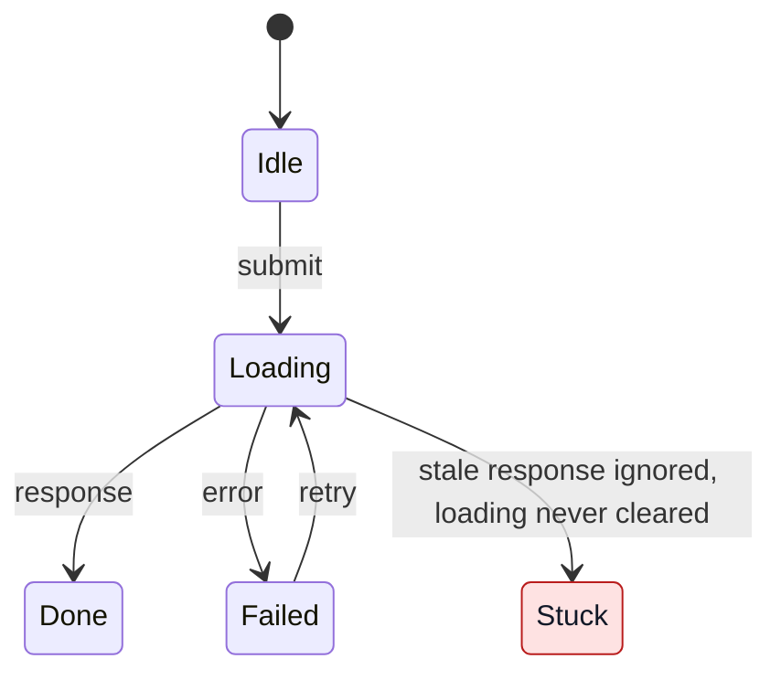

# Diagrams and publishing

Use native Mermaid blocks in the report. Keep diagrams under about 12 states
and use the same state names as the text. For example, a request whose stale
response is ignored without clearing the loading state:

Check rendered diagrams in both light and dark themes, especially highlighted
states, notes and sequence regions. Pair every custom node fill with an explicit
contrasting text colour. Use translucent sequence highlights so the theme's text
stays readable on its background.

Publish to a tracker or document only when explicitly requested. Preserve the
editable Mermaid source; do not replace it with PNG unless requested. Verify
that the diagrams render in the destination with readable labels and contrast
in both themes before reporting publication complete. Saved source alone does
not prove that the diagram is visible. If a rendering check is unavailable,
state which check remains unverified.
